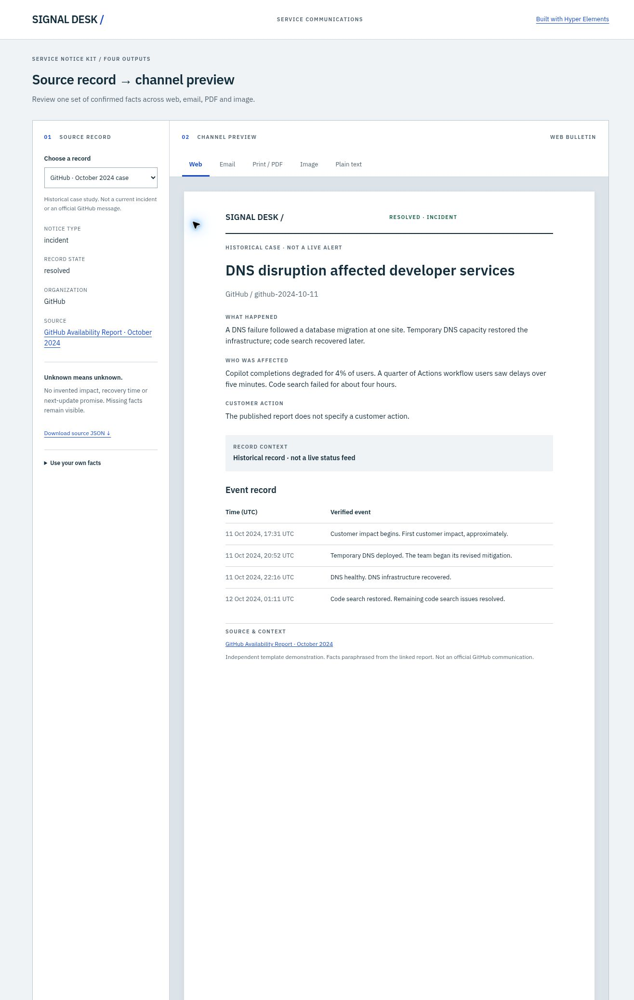

# Signal Desk /

**One verified incident record. Four consistent communications.**

Signal Desk is a Hyper Elements template kit for service teams that need to explain an incident without rewriting the same facts for every channel. It generates a responsive web bulletin, table-based email with a plain-text alternative, an explicitly paginated A4 PDF and a 1200 × 630 PNG.

It is intentionally **not** a monitoring dashboard. No invented uptime charts, fake customer counts or simulated live feed. The workbench opens with an empty draft. An optional historical case is paraphrased from GitHub's own October 2024 availability report, with visible attribution and a “not a live alert” label in every format.



## Run it

Node.js 22 or newer is recommended. Tested with Node.js 24.22.1.

```sh
npm ci
npm run build
npm run dev
```

Open `http://localhost:5173`. Choose **GitHub · October 2024 case** to see the sourced example. Switch between Web, Email, Print / PDF, Image and Plain text; download the actual output. The PDF preview is print HTML, while its download is a real PDF.

```sh
npm run typecheck
npm test
```

Tests that inspect generated artifacts require `npm run build` first. Installation needs npm access; rendering afterwards requires no network, API key, browser, account or paid service. The workbench makes same-origin requests for generated files only. Opening an attribution link is a normal external navigation.

## Use your own record

1. Copy `data/empty.json` to a new JSON file.
2. Supply confirmed facts and an HTTPS source. Keep `state: "draft"` until reviewed.
3. Use a unique lower-case, hyphenated `id`.
4. Render:

```sh
npm run render -- path/to/your-record.json
```

Find the artifacts under `dist/<id>/`. The two-record workbench is a reference gallery, not a form editor: custom records are rendered through the CLI and can be opened directly at `/<id>/web.html` while the preview server runs. No file is sent or published automatically. Review any newly supplied content at desktop and phone widths, and inspect its PDF/image for fit before distribution.

### Record contract

- `kind`: `incident` or `change`.
- Incident `state`: `draft`, `investigating`, `identified`, `monitoring`, `resolved`.
- Change `state`: `draft`, `scheduled`, `complete`. This changes the category/state labels; the supplied facts remain authoritative.
- `organization`, `title`, `summary`, `impact`, `action`: plain text, escaped by the renderer. Title ≤100 characters; summary ≤240; impact and action ≤400 each; organization ≤100. Event labels/details ≤120 each; source label ≤120; HTTPS URL ≤256.
- `nextUpdate`: an explicitly zoned ISO timestamp, or `null`. Null never becomes a made-up promise.
- `source`: `label`, HTTPS `url`, and `historical` boolean. A non-draft record requires a labeled source, title and summary.
- `events`: up to twelve confirmed, chronologically ordered entries with `at`, `label`, and `detail`. UTC is printed explicitly. No timestamps are invented.

Missing fields read “Not provided.” Missing timelines say no events were supplied. A historical record always reads “Historical record · not a live status feed,” rather than implying that an old incident is active.

## Meaningful Hyper Elements use

The template does not wrap a hand-written HTML email in an `Html` block. Its content and layout use actual Hyper Elements primitives throughout:

| Root | Output | Implementation |
| --- | --- | --- |
| `Page` | Responsive bulletin HTML | `WebNotice` + shared `Bulletin` |
| `Email` | Email-safe HTML and plain text | `EmailNotice` + shared `Bulletin` |
| `Document` | A4 PDF and print HTML | `PrintNotice`, `renderPdf()` |
| `Canvas` | PNG summary | `ImageNotice`, `renderImage()` |

`defineTheme()` supplies one palette and type system. `Column`, `Row`, `Heading`, `Text`, `Divider`, `Table`, `TableRow`, `TableCell` and `Link` implement the actual notice. The image is purposefully a shorter summary, not a screenshot of the webpage. The web gives the complete timeline; the email focuses on the latest event and a source-report action; the PDF separates the overview from a paginated chronology, with an archival label and printable source URL. Shared fact components keep their wording aligned. `validate()` and `outline()` write diagnostics and a layout outline beside each record.

The preview shell is ordinary HTML/CSS/JavaScript. Every notice shown inside it is rendered by Hyper Elements. Fonts are bundled from Fontsource; PDF/PNG receive local font bytes, while email intentionally falls back to Arial where Plex is unavailable.

## Files generated per record

```text
web.html             responsive bulletin
email.html           actual email HTML (not an emulator preview)
email.txt            readable email alternative
print.html           print-layout HTML
notice.pdf           real A4 PDF
notice.png           real 1200 × 630 PNG
record.json          source record, unmodified facts
outline.txt          Hyper Elements layout inspection
diagnostics.json     validation + render diagnostics
clients/             modeled Outlook, Gmail and Apple Mail previews
```

## Verification

- TypeScript check and 19 automated tests passed.
- All four roots validate without errors. PDF and PNG render diagnostics are empty for both supplied records.
- Semantic foreground colors pass 4.5:1 contrast against white in automated tests. Status also has explicit text; color is never the only signal.
- Browser-reviewed desktop workbench, all five output selectors, repeated record changes, and a 390px-wide mobile iframe harness.
- The historical PDF uses two explicit A4 pages: overview, then chronology. Each chronology page contains at most four events. A max-length text stress test was rendered and checked; overlong impact/action input is rejected instead of clipped.
- The generated PNG was visually inspected.
- The modeled classic Outlook preview was inspected in Chromium. Gmail and Apple Mail preview files were generated, not separately visually reviewed.
- Classic Outlook emits informational notes because it ignores letter spacing. The content remains readable. These are **local emulations, not actual inbox delivery tests**.
- No live email was sent. No production integration, screen-reader audit, cross-browser matrix or real-device mobile test is claimed. The PDF renderer does not currently produce a tagged PDF; use the web or plain-text output when semantic accessibility is required.

More visual evidence: [390px mobile review](docs/mobile.jpg), [modeled Outlook](docs/outlook.jpg), [generated summary](docs/summary.png).

## Research and source integrity

See [design and source notes](docs/RESEARCH.md). The design borrows proven information patterns, not branding or copied layouts: explicit incident status and impact, source-attributed chronology, restrained productive typography and consistent channel semantics.

The GitHub example is an independent demonstration, **not a communication sent by GitHub**. Its facts are paraphrased from the linked first-party report. The report describes infrastructure onset at 05:59 UTC and first customer impact around 17:31 UTC; the template's timeline deliberately starts at **customer impact**, not the earlier infrastructure onset. The final code-search restoration occurs the next day. No combined impact percentage or customer-affected duration is calculated.

## Challenge entry

Prepared for the [Hyper Elements Template Challenge](https://github.com/hyper-elements/hyper-elements/discussions/209). The kit addresses originality, design, practical value and effective library use through a source-preserving communications workflow. A public repository, repository star and official discussion submission are still required; this local build does not claim they have happened. No prize or acceptance is guaranteed.

## License

Original code: MIT, © 2026 Fortune Eze. IBM Plex: SIL Open Font License, included with generated assets. Dependencies retain their own licenses. GitHub's source report is linked for factual attribution; its branding and article are not bundled. Built with AI assistance; all included sample facts are source-linked.
